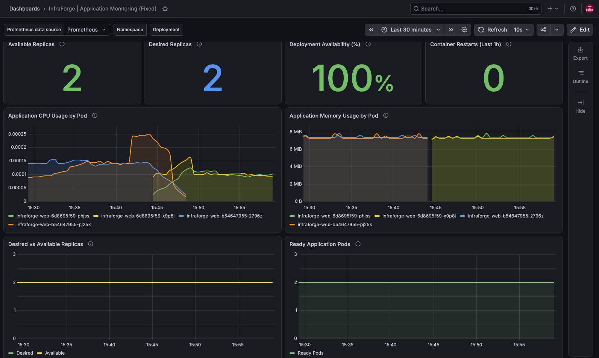

# InfraForge — End-to-End DevOps Automation & Monitoring Platform


**InfraForge** is a hands-on DevOps engineering project demonstrating automated CI/CD, Docker containerization, vulnerability scanning, multi-platform image publishing, Kubernetes deployment, monitoring, and recovery.

The application is a lightweight HTML/CSS website served by Nginx. The primary focus is on building and operating the infrastructure and automation surrounding the application.

## System Architecture


The architecture follows a practical DevOps workflow:

**Developer → GitHub → GitHub Actions → Docker → Trivy → GHCR → Kubernetes → Prometheus → Grafana**

- **GitHub:** Source control and version management.
- **GitHub Actions:** Automated builds, security checks, and application tests.
- **Docker:** Containerized Nginx application.
- **Trivy:** Container vulnerability scanning.
- **GHCR:** Container image storage and distribution.
- **Kubernetes (Kind):** Application orchestration, scaling, and recovery.
- **Prometheus:** Collection of Kubernetes and container metrics.
- **Grafana:** Visualization of application health and performance.

## Grafana Monitoring Dashboard



InfraForge uses Prometheus and Grafana to monitor its Kubernetes deployment.

The dashboard visualizes:

- Available and desired application replicas.
- Deployment availability percentage.
- Container restarts.
- CPU usage by pod.
- Memory usage by pod.
- Desired versus available replicas.
- Ready application pods.

**Validated monitoring state:** 2/2 replicas available, 100% deployment availability, and zero container restarts.

The dashboard also reflects changes during Kubernetes scaling and rolling deployments.

## Technology Stack

| Category                   | Technologies                   |
| -------------------------- | ------------------------------ |
| Application                | HTML, CSS, Nginx               |
| Version Control            | Git, GitHub                    |
| Containerization           | Docker, Docker Buildx          |
| CI/CD                      | GitHub Actions                 |
| Security                   | Trivy                          |
| Container Registry         | GitHub Container Registry      |
| Orchestration              | Kubernetes, Kind, kubectl      |
| Monitoring                 | Prometheus, Grafana            |
| Automation & Configuration | Bash, YAML                     |
| Development Environment    | macOS, VS Code, Docker Desktop |

## CI/CD Pipeline

GitHub Actions automatically validates application changes and publishes container images.

### Pipeline Stages

1. **Checkout:** Retrieve the latest source code.
2. **Build:** Build the Nginx application Docker image.
3. **Security Scan:** Scan for HIGH and CRITICAL vulnerabilities using Trivy.
4. **Application Test:** Start the container and verify its HTTP response.
5. **Multi-Platform Build:** Build AMD64 and ARM64 container images.
6. **Publish:** Push validated images to GitHub Container Registry.

**Container image:**

`ghcr.io/dp0912/infraforge-web:latest`

The pipeline supports automated build and publishing workflows. Deployment to the local Kubernetes cluster is performed separately using kubectl.

## Kubernetes Deployment

InfraForge runs on a local Kubernetes cluster created using Kind.

The deployment includes:

- Two application replicas.
- Kubernetes Deployment and ClusterIP Service.
- Rolling application updates.
- Pod health and availability verification.
- Manual horizontal scaling.
- Deployment rollback and recovery.
- Deployment using images published to GHCR.

### Deploy the Application

Clone the repository:

```bash
git clone https://github.com/dp0912/InfraForge.git
cd InfraForge
```

Apply the Kubernetes manifests:

```bash
kubectl apply -f kubernetes/deployment.yaml
kubectl apply -f kubernetes/service.yaml
```

Verify the deployment:

```bash
kubectl rollout status deployment/infraforge-web
kubectl get deployments
kubectl get pods -l app=infraforge-web
```

Access the application:

```bash
kubectl port-forward service/infraforge-web-service 8081:80
```

Open **http://localhost:8081**.

**Prerequisites:** Docker Desktop, Kind, kubectl, and a running local Kubernetes cluster.

## Deployment Recovery

InfraForge demonstrates Kubernetes rolling updates and rollback functionality.

Check deployment history:

```bash
kubectl rollout history deployment/infraforge-web
```

Roll back to a previous revision, if available:

```bash
kubectl rollout undo deployment/infraforge-web
kubectl rollout status deployment/infraforge-web
```

Kubernetes replaces application pods according to the deployment strategy and maintains the desired number of replicas.

## Project Structure

```text
InfraForge/
├── .github/
│   └── workflows/
│       └── ci.yml
├── docker/
│   └── Dockerfile
├── website/
│   ├── index.html
│   └── style.css
├── kubernetes/
│   ├── deployment.yaml
│   └── service.yaml
├── monitoring/
│   ├── values.yaml
│   └── dashboards/
│       └── InfraForge-Grafana-Dashboard.json
├── docs/
│   └── images/
│       ├── InfraForge DevOps System Architecture.png
│       └── grafana-dashboard.png
└── README.md
```

## Key Engineering Outcomes

- Implemented automated CI/CD using GitHub Actions.
- Integrated Trivy security scanning into the delivery pipeline.
- Built and published multi-platform Docker images to GHCR.
- Deployed and managed a containerized application using Kubernetes.
- Tested scaling, rolling updates, and deployment rollback.
- Configured Prometheus and Grafana for Kubernetes observability.
- Created a custom Grafana dashboard for application availability and resource monitoring.

## Project Information

**Application Version:** 1.1.0  
**Deployment Environment:** Local Kubernetes (Kind)  
**Container Registry:** GitHub Container Registry  
**Repository:** https://github.com/dp0912/InfraForge  
**Author:** [Dhruvin Patel](https://github.com/dp0912)

---

_InfraForge is a portfolio project focused on practical DevOps engineering, automation, container orchestration, security, and monitoring._
